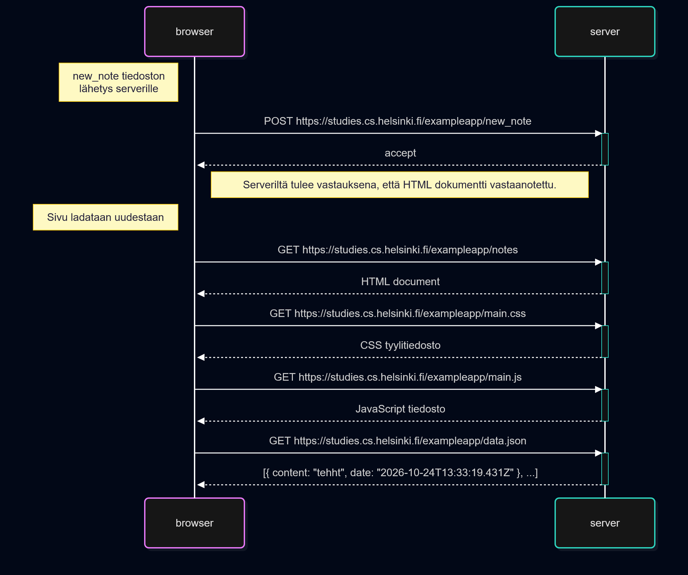

```sequenceDiagram
    participant browser
    participant server
    
    Note left of browser: new_note tiedoston</br>lähetys serverille
    browser->>server: POST https://studies.cs.helsinki.fi/exampleapp/new_note
    activate server
    server-->>browser: accept
    deactivate server
    Note right of browser: Serveriltä tulee vastauksena, että HTML dokumentti vastaanotettu.

    Note left of browser: Sivu ladataan uudestaan
    browser->>server: GET https://studies.cs.helsinki.fi/exampleapp/notes
    activate server
    server-->>browser: HTML document
    deactivate server

    browser->>server: GET https://studies.cs.helsinki.fi/exampleapp/main.css
    activate server
    server-->>browser: CSS tyylitiedosto
    deactivate server

    browser->>server: GET https://studies.cs.helsinki.fi/exampleapp/main.js
    activate server
    server-->>browser: JavaScript tiedosto
    deactivate server

    browser->>server: GET https://studies.cs.helsinki.fi/exampleapp/data.json
    activate server
    server-->>browser: [{ content: "tehht", date: "2026-10-24T13:33:19.431Z" }, ...]
    deactivate server
```

Varmuudeksi kuva lopputuloksesta:
