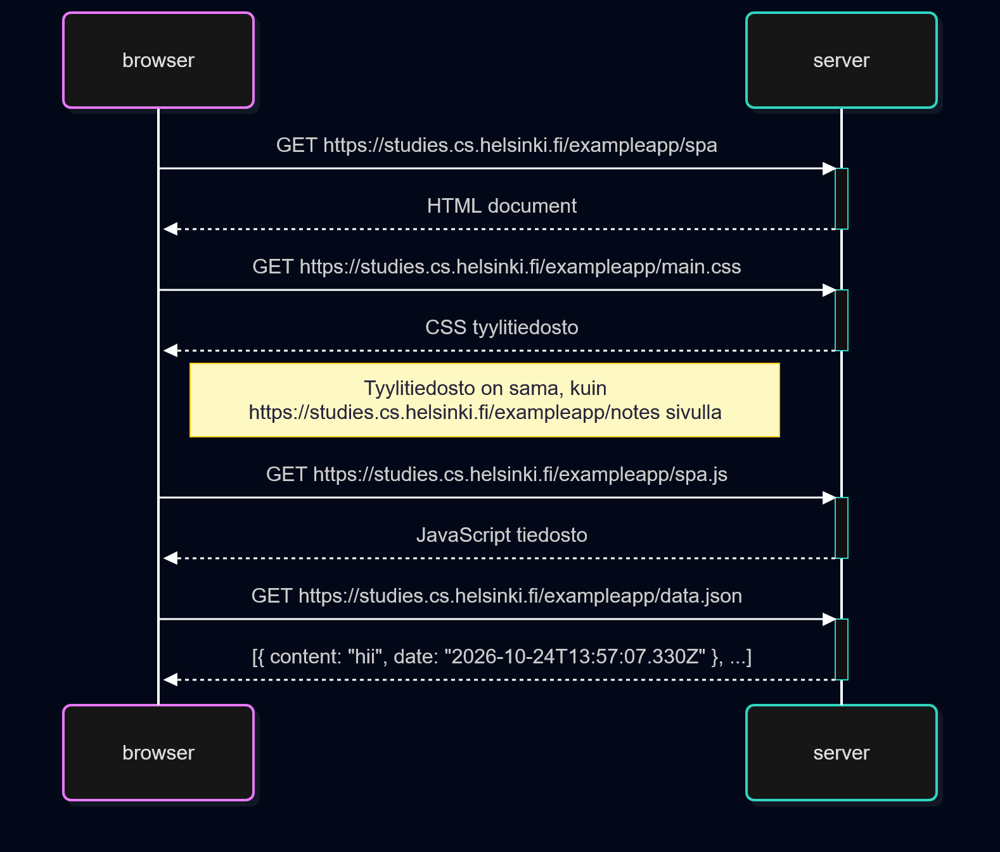

```
sequenceDiagram
    participant browser
    participant server
    
    browser->>server: GET https://studies.cs.helsinki.fi/exampleapp/spa
    activate server
    server-->>browser: HTML document
    deactivate server
    
    browser->>server: GET https://studies.cs.helsinki.fi/exampleapp/main.css
    activate server
    server-->>browser: CSS tyylitiedosto
    deactivate server
    Note right of browser: Tyylitiedosto on sama, kuin</br>https://studies.cs.helsinki.fi/exampleapp/notes sivulla

    browser->>server: GET https://studies.cs.helsinki.fi/exampleapp/spa.js
    activate server
    server-->>browser: JavaScript tiedosto
    deactivate server

    browser->>server: GET https://studies.cs.helsinki.fi/exampleapp/data.json
    activate server
    server-->>browser: [{ content: "hii", date: "2026-10-24T13:57:07.330Z" }, ...]
    deactivate server
```

Lopputulos kuvana:
